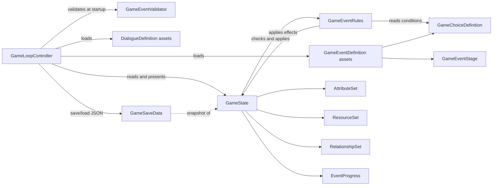
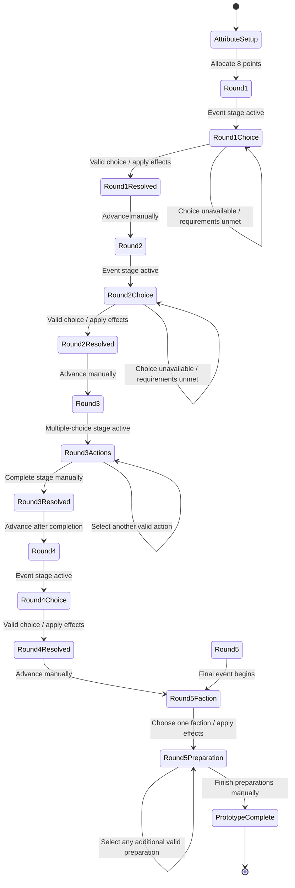

# Current Architecture

This document describes the prototype as currently implemented. It is a record of the implementation, not a claim that every planned system is complete.

## Runtime flow

Narrative content is authored in Unity `ScriptableObject` assets. At startup, `GameLoopController` loads event assets from `Resources/Data/Events` and indexes them by round. It also loads dialogue and room consultation assets. The controller renders the current round and sends player actions to `GameState`.

`GameEventValidator` checks the event catalog and each event definition at startup. Invalid definitions are reported in the Console and excluded from play. The same validator is covered by Edit Mode tests. `GameEventRules` evaluates whether a choice is currently available and applies its configured effects. `GameState` owns the current run, tracks selected choices and completed stages, records conversation responses, and advances rounds only after the current event is complete. The controller serializes a snapshot to JSON in `Application.persistentDataPath` when the player saves.

## Class model

The diagram focuses on the state and event-resolution systems. Dialogue assets and replies are also saved, but the response choices are not event choices: they update a relationship and mark that target as answered for the current round.

```mermaid
classDiagram
    class GameLoopController {
        -GameState state
        -Dictionary~int, GameEventDefinition~ eventsByRound
        -Dictionary~string, DialogueDefinition~ dialogues
        -Dictionary~string, string~ dialogueReplies
        -SaveGame()
        -LoadGame()
    }

    class GameState {
        +int CurrentRound
        +bool IsComplete
        +AttributeSet Attributes
        +ResourceSet Resources
        +RelationshipSet Relationships
        +TryChooseEvent(event, choice)
        +CompleteCurrentStage(event)
        +AdvanceRound(event)
        +RespondToCharacter(target, change)
    }

    class AttributeSet {
        +bool IsAllocated
        +int Diplomacy
        +int Warfare
        +int Management
        +int Combat
        +TryAllocate(...)
    }

    class ResourceSet {
        +int Influence
        +int Treasury
        +int Supplies
        +int Reputation
        +int Troops
        +Change(type, amount)
    }

    class RelationshipSet {
        -int[] values
        +Get(target) int
        +Change(target, amount)
    }

    class EventProgress {
        +string eventId
        +List~string~ selectedChoiceIds
        +List~string~ completedStageIds
        +bool isComplete
    }

    class GameEventDefinition {
        +string eventId
        +int roundNumber
        +bool isFinalEvent
        +List~GameEventStage~ stages
        +List~GameChoiceDefinition~ choices
    }

    class GameEventStage {
        +string stageId
        +EventSelectionMode selectionMode
        +int minimumSelections
        +bool manualCompletion
    }

    class GameChoiceDefinition {
        +string choiceId
        +string stageId
        +string buttonLabel
        +string resultText
        +List~GameCondition~ conditions
        +List~GameEffect~ effects
    }

    class GameCondition {
        +GameConditionType conditionType
        +AttributeType attribute
        +ResourceType resource
        +RelationshipTarget relationshipTarget
        +int minimumValue
        +string failureMessage
    }

    class GameEffect {
        +GameEffectType effectType
        +ResourceType resource
        +RelationshipTarget relationshipTarget
        +int amount
    }

    class GameEventRules {
        +CanChoose(state, event, choice)
        +ApplyEffects(state, choice)
    }

    class GameEventValidator {
        +ValidateCatalog(events, totalRounds)
        +ValidateDefinition(event, totalRounds)
    }

    class GameSaveData {
        +int saveVersion
        +int currentRound
        +bool isComplete
        +bool attributesAllocated
        +int diplomacy / warfare / management / combat
        +int influence / treasury / supplies / reputation / troops
        +List~int~ relationshipValues
        +List~EventProgress~ eventProgress
        +List~bool~ conversationResponses
        +List~DialogueReplyRecord~ dialogueReplies
    }

    class DialogueDefinition {
        +string dialogueId
        +int roundNumber
        +RelationshipTarget relationshipTarget
        +List~DialogueResponse~ responses
    }

    class DialogueResponse {
        +string playerResponse
        +string characterReply
        +int relationshipChange
    }

    GameLoopController --> GameState : presents and routes input
    GameLoopController --> GameEventDefinition : loads by round
    GameLoopController --> DialogueDefinition : loads conversations
    GameLoopController --> GameSaveData : serializes snapshot
    GameState *-- AttributeSet
    GameState *-- ResourceSet
    GameState *-- RelationshipSet
    GameState *-- EventProgress
    GameState ..> GameEventRules : resolves choices
    GameLoopController ..> GameEventValidator : checks assets
    GameEventDefinition *-- GameEventStage
    GameEventDefinition *-- GameChoiceDefinition
    GameChoiceDefinition *-- GameCondition
    GameChoiceDefinition *-- GameEffect
    GameEventRules ..> GameCondition : evaluates
    GameEventRules ..> GameEffect : applies
    DialogueDefinition *-- DialogueResponse
```

## Round state flow

Each configured round has one event asset. A round starts with its first incomplete stage. A successful choice records the choice and applies its effects once. Single-choice stages complete automatically unless configured for manual completion. Multiple-choice stages may complete automatically when their minimum is met, or wait for the player to finish the stage. Completing the last stage completes the event. The player then advances manually, except the final event ends the prototype after preparation.

Conversation responses are available alongside event progression. They are limited to one response per relationship target per round; each response changes that target's relationship by −1, 0, or +1. Saving and loading can happen during an allocated game and restore the current round, values, event progress, response flags, and dialogue reply text.

## Design patterns and architectural choices

| Choice | Current use | Reason |
| --- | --- | --- |
| Data-driven definitions | `GameEventDefinition` and `DialogueDefinition` are Unity `ScriptableObject` assets. | Content and conditions can be edited in Unity without adding a new resolution method for every decision. |
| Catalog validation | `GameEventValidator` checks event definitions and round coverage at startup and in Edit Mode tests. | Reports malformed content before the player reaches the affected round. |
| Rules/domain service | Static `GameEventRules` checks choice conditions and applies effects. | Keeps condition/effect evaluation out of the IMGUI drawing code and centralizes the rules. |
| State object | `GameState` owns the run's values, event progress and conversation response flags. | Gives UI and save/load a single runtime model to read or update through methods. |
| Configuration-driven staged flow | `GameEventStage` configures single/multiple selection, minimum selections and manual completion. | Supports the current one-choice, combined-action and faction-then-preparation flows with the same progression logic. |
| Snapshot DTO | `GameSaveData` is a plain serializable shape; `JsonUtility` writes it to disk. | Avoids trying to serialize runtime dictionaries or Unity assets directly and gives saves a schema version. |

These are practical architecture choices rather than a claim that the project implements every classic Gang of Four pattern. There is no separate event-bus/Observer system or polymorphic State-pattern hierarchy at this stage.

## Automated Edit Mode coverage

The NUnit Edit Mode assembly is `APlaceAmongLords.Tests.EditMode`. Its tests create temporary event definitions in memory and cover attribute requirements, one-time effect application, atomic rejection of invalid effects, minimum/manual completion of a multiple-choice stage, the two-stage final event, JSON save restoration, the project's complete event catalog, malformed event definitions, and missing-round detection. Run them from Unity's **Window > General > Test Runner > EditMode** panel.

The runtime code is split into `APlaceAmongLords.Data` and `APlaceAmongLords.Core` assembly definitions so the test assembly can reference both without moving production code into the test assembly.

## Current boundaries and follow-up work

- The prototype currently has five rounds and expects exactly one valid event per round. Startup validation checks event IDs and round coverage, event titles/descriptions, stage and choice IDs, stage selection configuration, conditions, and effects.
- `GameSaveData.saveVersion` is currently `1`. A future change to the serialized schema should increment it and add a migration or clear compatibility response.
- Relationship response flags use a fixed array sized for five rounds and the current six `RelationshipTarget` values. If targets or round count become content-driven, replace this with keyed progress data.
- Resources have a lower bound of zero; relationships clamp to −5 through +5. Resource upper bounds and balancing rules are not defined yet.
- Conditions currently check minimum values for an attribute, resource, or relationship. Effects currently change a resource or relationship.
- The runtime UI still uses Unity IMGUI. Presentation and content expansion can be handled separately from the event rules and state model.

## Main implementation files

- `Assets/Scripts/Core/GameState.cs` — runtime state, progression and snapshot conversion.
- `Assets/Scripts/Core/GameEventRules.cs` — condition evaluation and effect application.
- `Assets/Scripts/Core/GameEventValidator.cs` — event catalog and definition validation.
- `Assets/Scripts/Core/GameSaveData.cs` — JSON save schema.
- `Assets/Scripts/Core/GameLoopController.cs` — asset loading, UI, event routing and persistence.
- `Assets/Scripts/Data/GameEventDefinition.cs` — event, stage, condition and effect definitions.
- `Assets/Scripts/Data/DialogueDefinition.cs` — dialogue and relationship response definitions.
- `Assets/Scripts/Data/AttributeSet.cs`, `ResourceSet.cs`, `RelationshipSet.cs` — model value objects.
